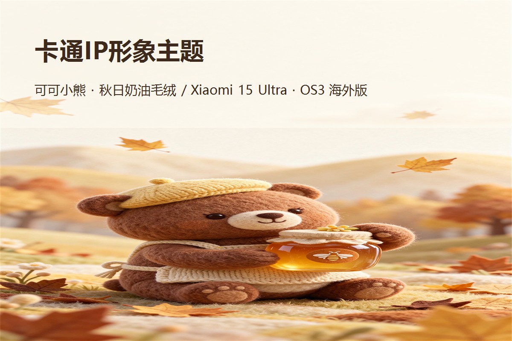
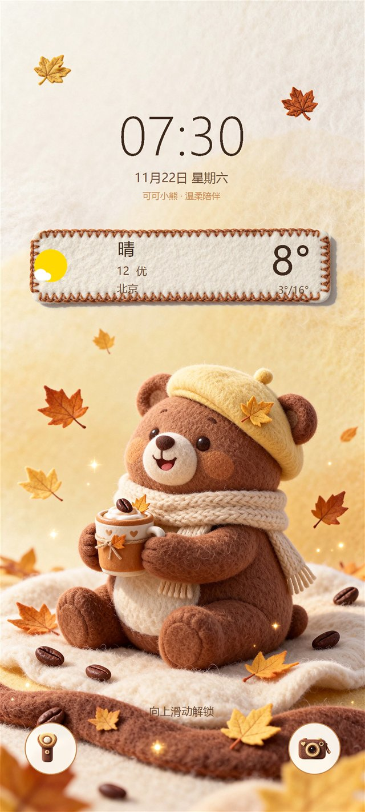
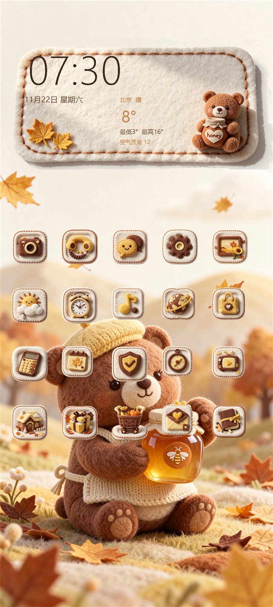
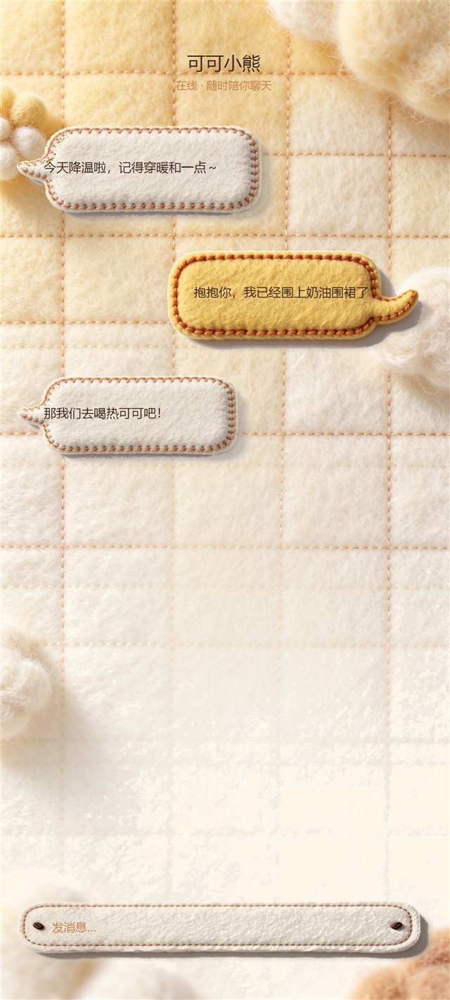
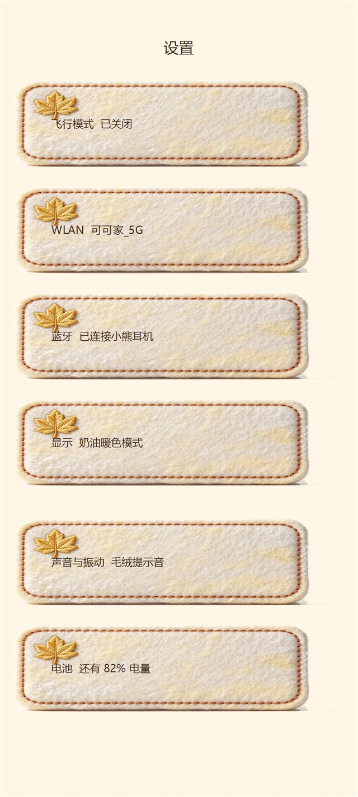
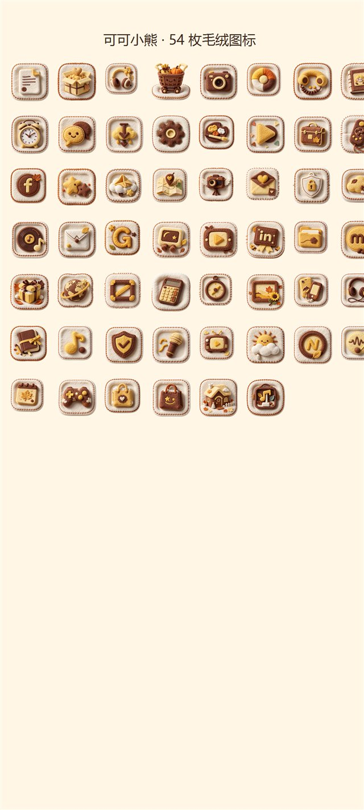

# 001-卡通IP形象主题 / 可可小熊 · 秋日奶油

原创 IP「可可小熊」的秋季暖色毛绒主题，面向 Xiaomi 15 Ultra / HyperOS 3 海外版（Global）交付。

## 下载

主题包 71.41 MB，从 Release 下载：**[卡通IP形象主题 v1.0.1 · 9-patch 修复](https://github.com/kahao-git/cocoa-bear-theme/releases/tag/v1.0.1)** → 附件 `cocoa-bear-theme-v1.0.1.mtz`

> 请务必用 v1.0.1。v1.0 包内 `dialerpad_background.9`、`message_bubble_out_thumbnail_last_bg_n.9`、`l46pevdo_bg.9` 三张图的 1px 边框不合规，导入时会被 9-Patch Errors 校验拦下。

安装：把 .mtz 放到手机存储任意目录，打开「主题壁纸 → 我的 → 从本地导入」，选中该文件即可应用。

## 设计说明

- 风格：ins 可爱风，奶油白 / 奶油黄 / 玉米黄 / 米白 四阶暖色打底，深可可 #3E2A1D 做文字与描边，焦糖 #C5854B 做缝线与强调。
- 材质：全站统一为毛绒布艺 + 手工毛线锁边 + 布贴刺绣，所有 9-patch 都有一个焦糖色手缝边。
- IP：可可棕毛绒小熊，奶油围裙、蜂蜜罐、枫叶帽，贯穿壁纸、锁屏、小组件与图标。
- 可读性：所有文字层统一落在奶油底上，正文用深可可，次级信息用可可棕，避免白字压浅底。

## 小米后台填写字段

标题：卡通IP形象主题

描述：

> 原创毛绒小熊 IP「可可小熊」打造的秋季奶油暖色主题。奶油白与玉米黄的毛毡质感铺满桌面、锁屏与界面，手工毛线锁边缝线贯穿角标与卡片，小熊抱着蜂蜜罐坐在落叶里。包含 1080×2400 桌面与锁屏壁纸、可滑动解锁的锁屏（时间、日期、天气卡、手电筒、相机、飘叶动效）、54 枚透明毛绒图标、天气时钟小组件 4 种尺寸、控制中心与通知下拉面板、短信收发气泡与输入框、设置与通讯录卡片配色，适配 Xiaomi 15 Ultra / HyperOS 3 海外版。

标签：小熊、毛绒、奶油色、秋天、可爱、原创IP、暖色调

附加说明：由 jvyiyv 独立设计与制作，图标、壁纸、面板、锁屏配图全部为本次原创生成素材。

## 版本与交付

| 系统 | 当前版本 | 本地包 | 直接复制文案 |
| --- | --- | --- | --- |
| OS3 | 1.0.1 | [cocoa-bear-theme-v1.0.1.mtz](https://github.com/kahao-git/cocoa-bear-theme/releases/download/v1.0.1/cocoa-bear-theme-v1.0.1.mtz)（71.41 MB） | SUBMISSION_OS3.txt |

## 内容清单

| 模块 | 内容 |
| --- | --- |
| wallpaper | 桌面壁纸、锁屏壁纸，1080×2400 |
| lockscreen | MAML 锁屏：时间、日期、天气卡（实时天气/AQI/城市）、手电筒开关、相机快捷、上滑解锁、双枫叶飘动 |
| icons | 54 枚 512×512 透明 PNG，按包名命名 |
| clock_2x2 / 2x4 / 3x4 / 4x2 | 天气时钟小组件，含时间、日期、城市、温度、温差、空气质量，点击进入天气 |
| com.android.mms | 收发气泡、输入栏、会话顶栏、附件页、收件人列表等 19 项 9-patch / 位图 |
| com.android.contacts | 拨号盘背景、顶栏、底部导航、弹窗、联系人条目等 |
| com.android.settings | 设置窗口、偏好卡片组、搜索框等 |
| com.android.systemui | 通知卡片、全屏下拉面板背景、调色 |
| com.miui.home / miui.systemui.plugin / framework-res 等 | 桌面搜索栏、状态栏与控件配色 |

## 预览

| 锁屏 | 桌面 |
| --- | --- |
|  |  |
| 短信 | 设置 |
|  |  |

## 分层 PSD

`cocoa-bear-theme_Layered_PSD.zip`（14.5 MB）内含 5 个 PSD，尺寸与原预览一致 640×1422、8 位 RGBA，可直接在 Photoshop 打开改图。

| 文件 | 图层 | 分层方式 |
| --- | --- | --- |
| 01-lockscreen.PSD | 5 层 | 壁纸与天空 / 时间日期 / 信息卡 / IP 插画 / 解锁提示与按钮 |
| 02-home.PSD | 4 层 | 壁纸 / 状态栏 / 图标网格 / 组件与页点 |
| 03-messages.PSD | 3 层 | 背景 / 气泡区 / 顶栏与输入栏 |
| 04-settings.PSD | 3 层 | 背景 / 列表卡片 / 标题与搜索 |
| 05-icons.PSD | 2 层 | 背景 / 图标网格 |

> 说明：本套主题的原始工程文件未随仓库保存，分层按功能分区（背景 / 文字 / 信息卡 / 插画 / 交互件）从成品预览切片建立，各层按「正片叠底」顺序合并后与预览图逐像素一致。它适合改色、换字、替换局部插画；若需要对象级精修（每个图标、每片枫叶独立可编辑），需回到源工程重新导出。

## 核验记录

- 图标：54 枚全部为 512×512 透明 PNG，命名与包名一一对应，已核验计数。
- 9-patch：气泡、输入栏、卡片、面板共 28 项按目标模块重新生成，左/上伸区与右/下内容区标记齐备；气泡尾巴与缝线完整，白底与阴影已透明化。
- 9-patch 合规（1.0.1 补充）：工程内 45 张 .9.png 逐张核对 1px 边框 —— 四角全透明、边框像素只能是纯黑标记或全透明，四个边各有一处连续标记。修复了 3 张边框被覆盖操作冲掉的图，其余 42 张原本合规。
- 锁屏：manifest / main / origin 三份一致，XML 通过解析校验；天气列名与 content provider 一致。
- 小组件：manifest 与 widget_layout.json 的 canonicalXML 逐份比对一致。
- 主题配色：7 个模块 theme_values 全量替换旧棕色阶到新奶油色阶，浅底文字改为深可可。
- 打包：.mtz 为 19 个条目（15 个模块内层 zip + description.xml + wallpaper 目录与两张壁纸），可正常解包。

## 变更记录

- 2026-11-22：首发版本 1.0，完成素材、模块替换、锁屏与小组件重写、打包与预览图。
- 2026-11-22：1.0.1 修复导入时的 9-Patch Errors（dialerpad_background / message_bubble_out_thumbnail_last_bg_n / lockscreen l46pevdo_bg 三张边框不合规），重打包。
- 2026-11-23：目录重构进 `主题/001 - 卡通 IP 形象主题/`；追加真分层 PSD 包，替换原先由 JPG 直接改后缀的伪分层包。
