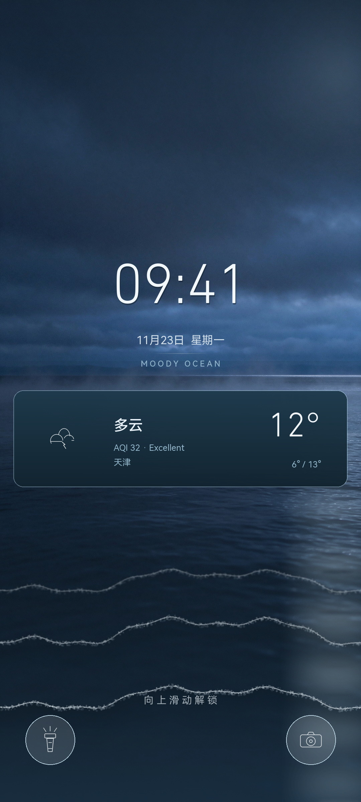
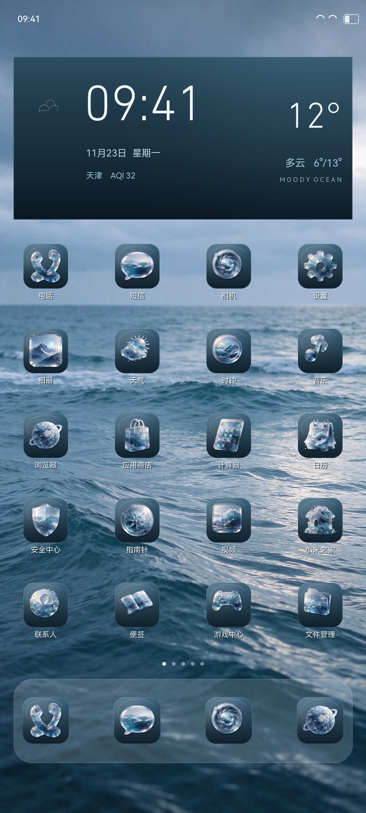
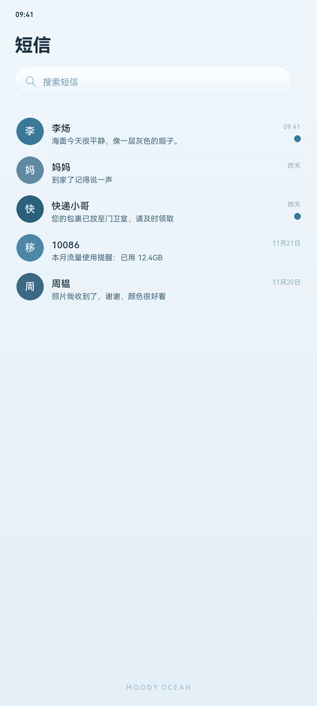
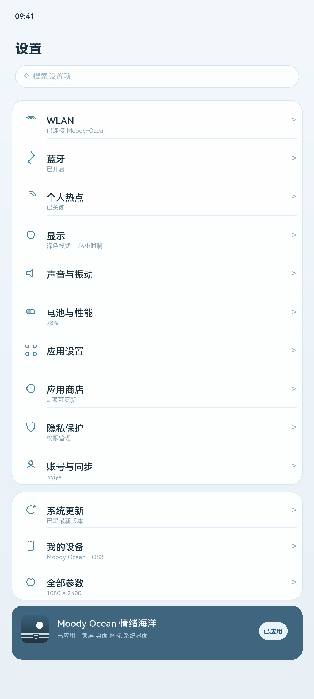
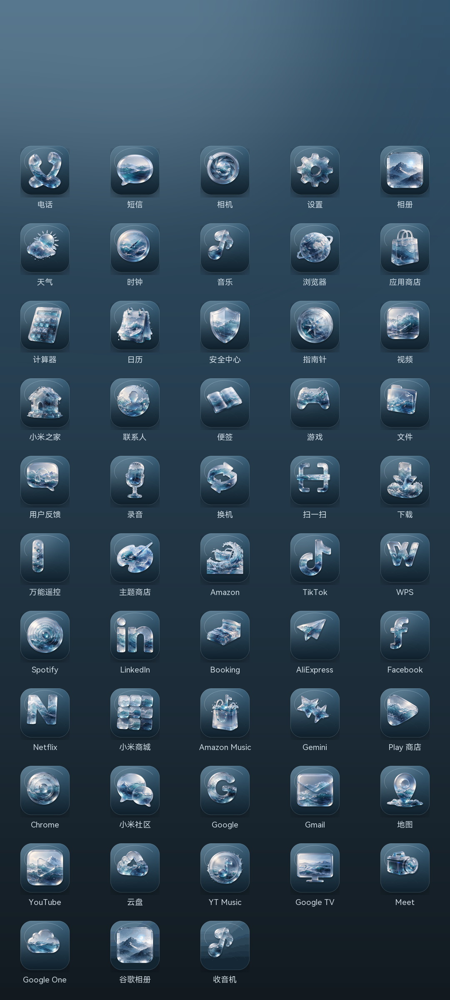

# Moody Ocean 情绪海洋

海外版（Global）小米主题 · HyperOS 3 · 电影感的灰蓝海水，安静、克制、略带忧郁。

- 设计师 / 作者：jvyiyv
- 版本：1.0 · uiVersion 17 · editorVersion 2.0.8 · miuiAdapterVersion 3.3
- 主题包：`Moody Ocean 情绪海洋.mtz`（8.3 MB，标准 zip 结构，无签名）
- 适配：1080 × 2400（Xiaomi 15 Ultra / HyperOS 3 海外版）

## 预览

| 锁屏 | 桌面 |
| --- | --- |
|  |  |
| 短信 | 设置 |
|  |  |



## 交付项

| # | 项目 | 实现 |
| --- | --- | --- |
| 1 | 动态锁屏 | MAML 百变锁屏：三层海浪呼吸起伏（bob）、重力传感器视差、月光缓慢呼吸、上滑解锁时浪线与文字淡出上扫 |
| 2 | 静态桌面壁纸 | `wallpaper/default_wallpaper.jpg` 1080×2400，海面微光 + 层云 + 高光带 |
| 3 | 锁屏文字与主题统一 | 时间 DIN Next LT Pro Light、日期 / 城市 HarmonyOS Sans，色板 #E8F1F7 / #9FC3D8 / #BBD4E2 |
| 4 | 快捷入口可用 | 手电筒（`Button` + `ExternCommand`）、相机、上下滑动解锁均绑定真实命令 |
| 5 | 天气 / 时间 / 日期 | `ContentProviderBinder` 实时读取 `content://weather/actualWeatherData/1`：城市、天气类型、温度、温差、AQI；时间 / 日期走 MAML 全局变量 |
| 6 | 解锁动画 | 滑动拖拽位移 + 浪层与文字分层淡出，解锁瞬间浪线向上扫出 |
| 7 | 图标 | 53 枚统一风格图标（磨砂玻璃 + 海水质感），工程内覆盖 86 个常用包名 |
| 8 | 系统界面统一 | 通讯录 / 电话 / 短信 / 设置 / 通知下拉 / 控制中心 / 桌面与框架配色全部重制；短信为列表页深字浅底 + 收发气泡 + 9-patch 搜索框与输入栏（输入框为九宫格 + 内容内边距，文字不贴圆角），标题「短信」常显 |
| 9 | 桌面天气小组件 | 2x2 / 2x4 / 3x4 / 4x2 四种尺寸，含时间、日期、城市、温度、温差、AQI 与天气图形，点击进入天气 |
| 10 | 分层 PSD | `Moody Ocean 情绪海洋_Layered_PSD.zip`：01 锁屏 16 层、02 桌面 10 层、03 短信列表 5 层、04 设置 5 层、05 图标 4 层 |

## 目录

```
lockscreen/advance/   manifest.xml + main.xml（同一份 MAML）+ art/（浪层、月光、海平线、反光、手电、相机）
wallpaper/            default_wallpaper.jpg / default_lock_wallpaper.jpg
icons/                86 个包名图标，512×512 RGBA（256 色量化）
clock_2x2 / 2x4 / 3x4 / 4x2   小组件底板 + wx/ 天气图形
com.android.contacts / mms / settings   拨号盘、气泡、设置卡片
com.android.systemui  通知卡片、下拉面板
com.miui.home / fliphome / miui.systemui.plugin / framework-res / framework-miui-res   桌面与框架配色
```

## 设计说明

- 色板：深墨蓝 #1B3140、次级 #44657A、湖蓝 #4E86A6、雾白 #F2F7FB；气泡发送渐变 #30688A→#3A88A8。
- 系统界面走「深色外壳 + 浅色内容」：设置 / 信息用雾白底（#F7FBFD / #EDF5FA）+ 深墨蓝文字（#1B3140），下拉与通知用深蓝半透明，避免整屏发灰、也避免深底压深字。
- 界面素材（设置底图、搜索框、气泡、拨号盘、通知卡片）全部用脚本自绘，不使用任何第三方主题素材像素；9-patch 只沿用目标尺寸与拉伸标记。
- 图标统一 45° 高光与底部暗角，保留各自品牌轮廓，缩到 48dp 仍能辨认。

## 校验

- 73 个 9-patch 全部通过 `check9.py` 结构校验（边框 marker + 三段拉伸，0 处非法）。
- 图标 512×512、256 色量化后单枚平均 18 KB，整包 8.3 MB（商店上限 30 MB）。
- 预览图 1080×2400 JPEG q93；`preview/` 随包附带锁屏 3 帧与桌面帧。

## 使用

1. 手机端：主题商店 → 我的 → 从本地导入 `.mtz`。
2. 编辑：用 Xiaomi Theme Editor（Global 2.0.8）打开工程目录，或直接改 `lockscreen/advance/main.xml` 后重新打包。
3. `Layered_PSD` 解压后用 Photoshop 打开，图层名按 `01`–`16` 顺序自下而上排列。

## 备注

- `.mtz` 由标准 zip 结构自建（`description.xml` + 模块目录 + `preview/`），Theme Editor 导出入口在本机不可用，包体未含签名文件。
- 锁屏 MAML 中 `Circle` 的 `alpha` 属性未在旧模板中验证过，若个别机型不认，可改为静态 ARGB 颜色。
