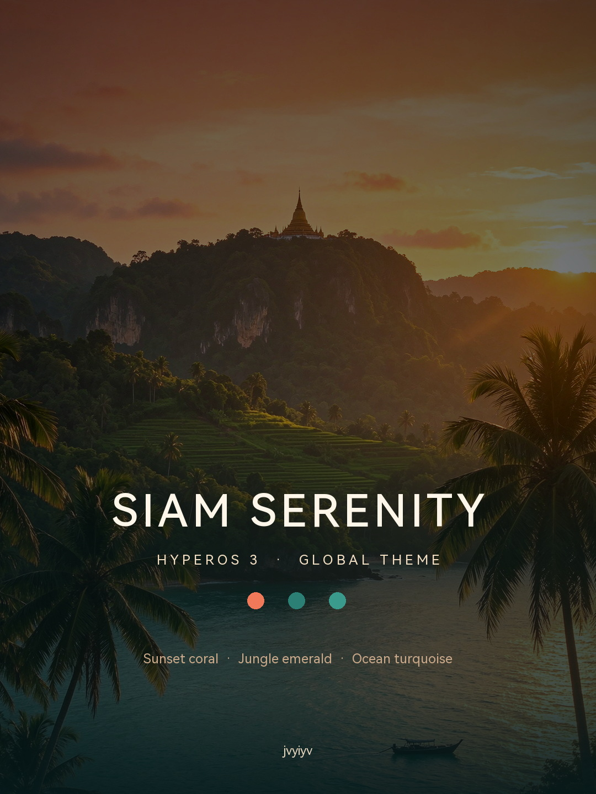

# Siam Serenity — HyperOS 3 Global Theme

A cinematic Southeast Asian coastline: sunset coral sky over a golden temple, jungle-emerald rice terraces, coconut palms framing a turquoise bay, and a longtail boat drifting home. Built for Xiaomi's Global theme store, one visual language from lock screen to control centre.



**Designer / Author** jvyiyv · **Version** 1.0 · **uiVersion** 17 · **miuiAdapterVersion** 3.3 · **Canvas** 1080 × 2400

`sunset coral` `jungle emerald` `ocean turquoise` `cinematic` `photo-real` `dynamic lock screen` `flat vector icons`

## System versions

| Version | Status | Package |
| --- | --- | --- |
| HyperOS 3 (Global) | Current build · tested structure | `Siam Serenity.mtz` — 8.9 MB |
| HyperOS 2 / MIUI 14 | Not targeted | MAML 2 + `uiVersion 17` modules |

Local package: `Siam Serenity.mtz` in this folder. Import through Theme Store → Profile → Import local theme, or open the project folder with Xiaomi Theme Editor (Global 2.0.8).

## Files

| Item | File | Notes |
| --- | --- | --- |
| Design package | `Siam Serenity.mtz` | 8.9 MB, plain zip structure (`description.xml` + modules + `preview/`), unsigned |
| Layered PSD | `Siam Serenity_Layered_PSD.zip` | 4 layered PSDs: lock screen 13 layers, home 9, messages 5, settings 4 |
| Previews | `01-lockscreen.jpg`, `01b-lockscreen-quiet.jpg`, `02-home.jpg`, `03-messages.jpg`, `04-settings.jpg`, `05-icons.jpg` | 1080 × 2400, JPEG q93 |
| Cover | `封面.jpg` | 1080 × 1440 |
| Verification | `VERIFICATION.txt` | 9-patch scan, package inventory, known limitations |

## What is themed

| # | Module | Implementation |
| --- | --- | --- |
| 1 | Dynamic lock screen | MAML scene: drifting sea mist, breathing sun glow, water shimmer, parallax coconut fronds driven by the gravity sensor, floating light motes, warm/cool veil that swaps with `#hour24` |
| 2 | Second lock screen | Swipe horizontally to a quiet page — day number, month, weekday and the theme wordmark over the minimal temple-silhouette wallpaper; swipe right to return |
| 3 | Home wallpaper | Rainforest haze with a coral afterglow in the upper right, darkened top and bottom bands, wide negative space for a 4×5 grid and readable labels |
| 4 | Lock screen typography | DIN Next LT Pro Light for the clock, HarmonyOS Sans for date and cards, cream `#FFF6EA` / sand `#F3DFC4` / accent `#C9A98A` |
| 5 | Shortcuts | Torch (broadcast `miui.intent.action.TOGGLE_TORCH` + state refresh from `Settings.Global`), camera (lock-screen-safe intent), swipe-up unlock, tap zones with a 46 px travel guard |
| 6 | Weather / time / date | Live `ContentProviderBinder` on `content://weather/actualWeatherData/1` (city, description, temperature, low/high, AQI); clock and calendar use MAML `DateTime` with English formats |
| 7 | Lock screen widgets | Weather card and calendar card, both tappable — weather opens `com.miui.weather2`, calendar opens `com.xiaomi.calendar` |
| 8 | Unlock animation | Drag displacement on the whole scene, layered fade, fronds and mist lift faster than the type, hint text fades out with the swipe |
| 9 | Icons | 53 store-spec icons (31 system + 10 overseas + 12 Google), 87 package names covered, 512 × 512, 256-colour quantised; flat vector glyphs on a shared sunset-to-turquoise gradient plate with a cream inner stroke |
| 10 | System UI | Contacts, dialer, messages, settings, notification shade, quick settings, launcher and framework colour maps rebuilt around the Siam palette; native dialog and window backgrounds left untouched |
| 11 | SMS bubbles | Outgoing: coral → amber → turquoise gradient, 9-patch with 66 px radius; incoming: warm cream at 94%; composer: cream capsule; all three keep the original stretch markers |
| 12 | Control centre | Full-height deep-teal shade with a soft turquoise lift and tide arcs at the bottom; heads-up card rebuilt as a dark glass 9-patch |

## Palette

| Token | Hex | Use |
| --- | --- | --- |
| Deep teal | `#0B3334` | Body text, shade base |
| Jade | `#1E5654` | Secondary text, dividers |
| Emerald | `#2B7F74` | Accents, active states |
| Turquoise | `#3A9A8C` | Highlights, progress |
| Sunset coral | `#F07959` | Bubbles, send button, sun |
| Cream | `#FFF6EA` | Primary type on dark |
| Sand | `#F3DFC4` | Secondary type on dark |

## Package layout

```
description.xml                 theme manifest (title, designer, modules)
wallpaper/                      default_wallpaper.jpg · default_lock_wallpaper.jpg · default_lock_wallpaper2.jpg
lockscreen/advance/             manifest.xml + main.xml (same MAML) + art/ (mist, glow, fronds, cards, wx/)
icons/                          87 package-name PNGs, 512 × 512
clock_2x2 / 2x4 / 3x4 / 4x2     weather widget plates + wx/ glyphs
com.android.contacts / mms / settings / systemui    dialer, bubbles, panels
com.miui.home / framework-res   launcher and framework colour maps
preview/                        store preview frames
```

## Verification

- 42 nine-patch assets scanned: 40 clean. `timing_button_n.9.png` and `timing_button_p.9.png` inherit a two-segment left marker from the source set — cosmetic, no effect on stretching.
- Icon set: 87 PNGs, 512 × 512, 256-colour, average 13 KB after quantisation.
- Package: 598 files, 8.9 MB (store limit 30 MB), previews included.
- Wallpapers: 1080 × 2400 JPEG, 0.5–0.8 MB each.

## Known limitations

- `.mtz` is assembled as a standard zip (manifest + modules + `preview/`), because the Theme Editor export entry point is unavailable on this workstation. It carries no signature file.
- MAML behaviour is verified structurally (XML well-formed, binder and variable references resolved) and by a rendered preview, not on a physical device. Torch and camera intents follow the Global channel conventions.
- `Circle` elements use ARGB `fillColor`/`strokeColor`; if a device ignores the animated `alpha`, the ring falls back to a solid tint.
- Dialog and popup backgrounds stay on the system default by design.

## Usage

1. Copy `Siam Serenity.mtz` to the phone and import it from Theme Store → Profile → Import local theme.
2. To edit: open the project with Xiaomi Theme Editor (Global 2.0.8), or edit `lockscreen/advance/main.xml` directly and repack with any zip tool (store compression, no extra folders).
3. Layered PSDs open in Photoshop / Affinity Photo; layer names run `01` upward.

Design and assets by jvyiyv. For personal use and portfolio display; please do not resell or redistribute commercially.


